# 定例行事

### 読書会・聖書研究会

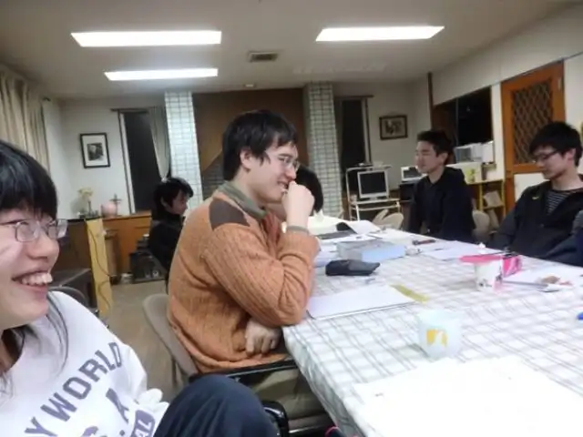

担当の寮生が自由にテーマを決め、ワークショップを企画します。活動を通して、仲間の新しい一面に出会う機会にもなっています。

これまでに、「太宰治『駆け込み訴え』を読む」「落語のススメ」「ウクライナと情報戦」「『大人』とは」などのテーマが取り上げられました。

聖書研究会では、聖書の理解を深めたり、日常生活と聖書の関わりを考えたりします。

[寮生文集「読書会・聖書研究会」を読む](/messages/book-and-bible/)

### 寮生総会

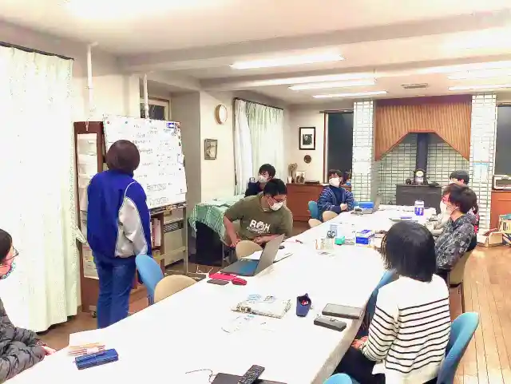

月に一度、行事の企画や建物のこと、寮費など、寮生活に関わる事柄を話し合います。寮生の意見を寮の運営に反映する場です。

### 朝拝

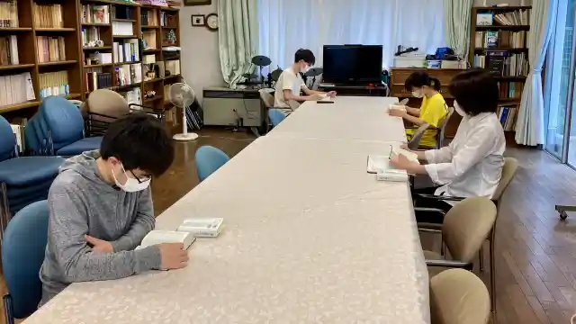

朝食の前に5〜10分程度集まり、讃美歌を歌い、聖書を輪読します。当番が近況などを記す「朝拝ノート」も、寮生同士が互いを知る機会になっています。

[寮生文集「朝拝」を読む](/messages/morning-worship/)

# 年中行事

### 入寮式・4月

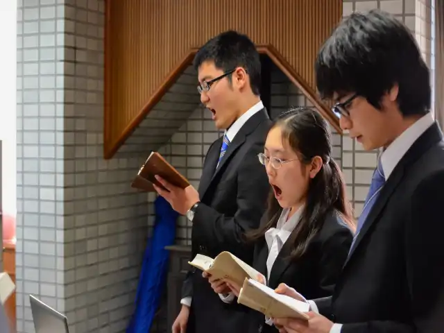

新入寮生を歓迎する式典です。新入寮生は自己紹介のスピーチを行います。

### 花見・4月

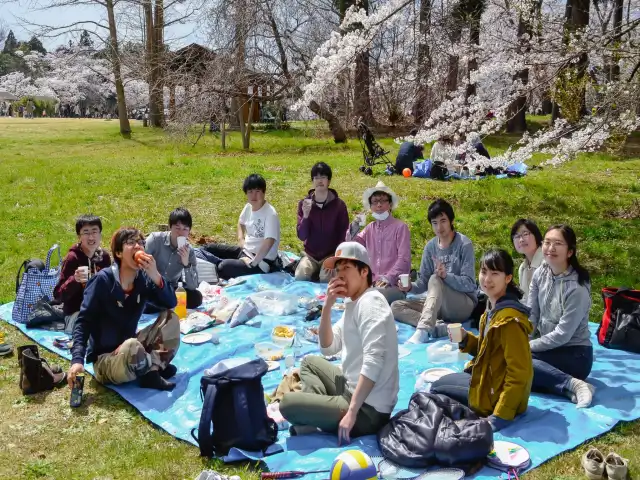

近所のお花見スポットに赴きお花見をします。

### 献堂記念式・6月

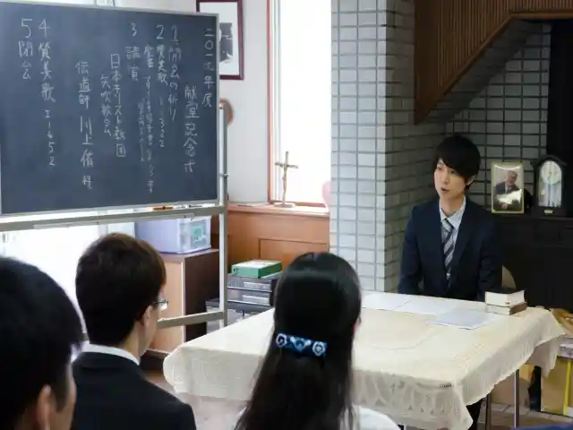

講師の先生をお招きしてお話をいただきます。

### 夏季ゼミ・9月

南は九州から北は北海道（果ては海を渡ってお隣の国）まで日本全国の学生YMCA会員が集まり、今の世界の問題点について真剣に考えたり、夜遅くまでお酒を飲みつつ語り合ったりします。

### NSCF・9月

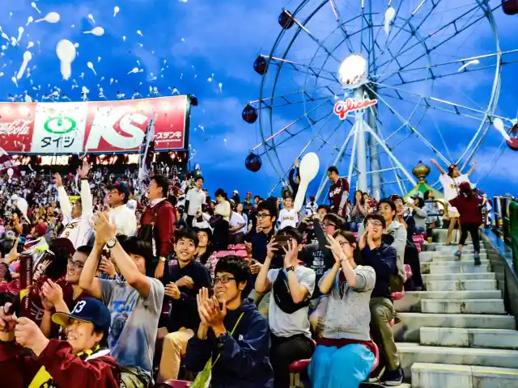

北海道大学YMCA汝羊寮の学生と交流します。

### 芋煮会・10月

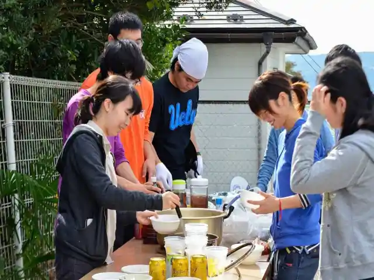

東北地方の慣例行事です。芋煮とよばれる料理（豚汁）をみんなでつくって食べます。秋のお花見のような行事です。

### クリスマス会・12月

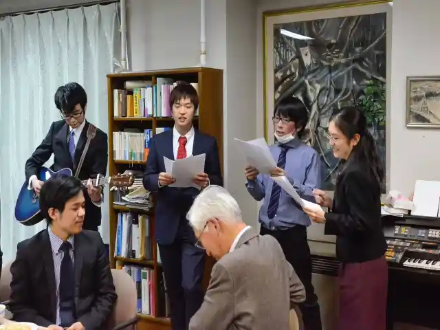

クリスマスをお祝いする行事です。講師の先生をお招きしてお話をいただきます。

### 冬ゼミ・2月

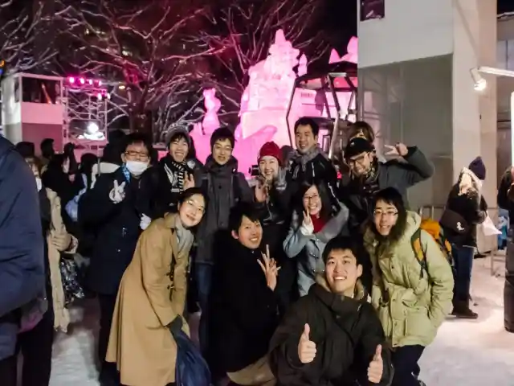

北海道大学YMCA汝羊寮の学生と交流します。

### 卒寮式・3月

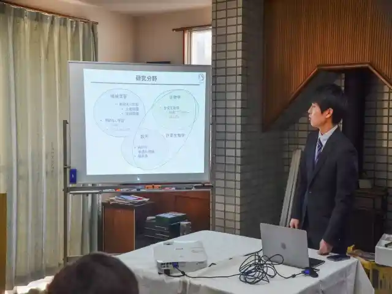

卒業する寮生を送り出す式です。卒寮生が4年間の想いをスピーチにします。
