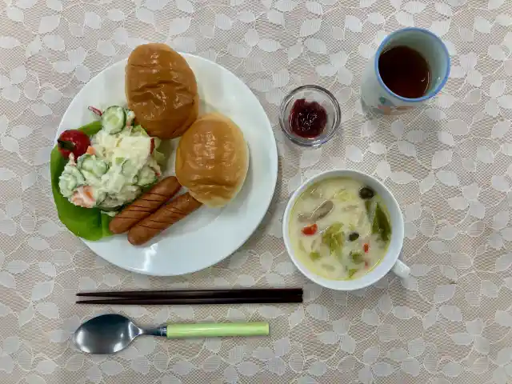
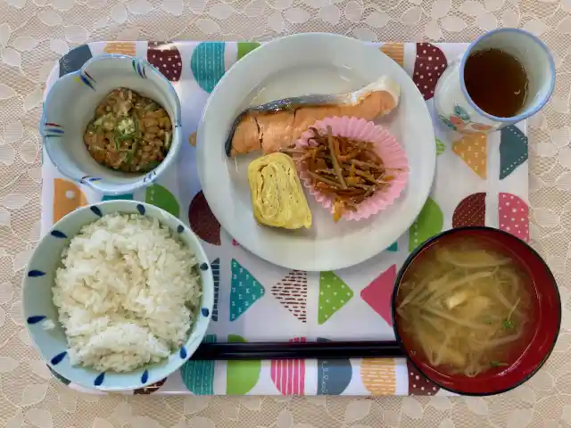
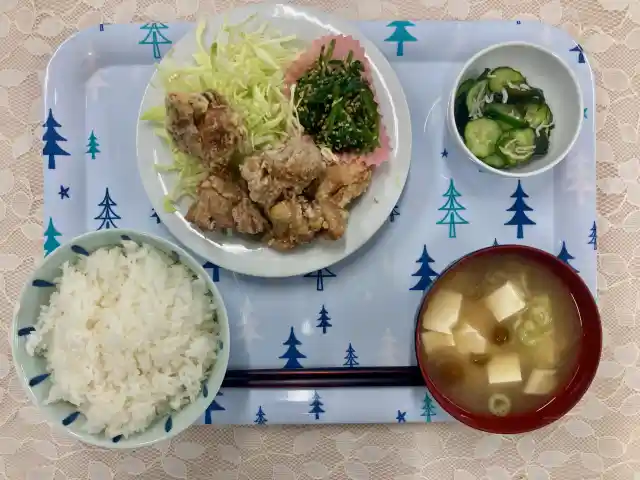

## 食卓がつなぐ日常

寮生に、渓水寮に住み続ける理由を聞くと、「ご飯」という答えをよく耳にします。寮に帰れば、おいしいご飯があり、一緒に食べる仲間がいる。食事は、毎日の暮らしを支えるとともに、寮生が帰り、顔を合わせるきっかけにもなっています。

渓水寮には、献堂記念式や入寮式といった大きな行事のほか、総会、読書会、聖書研究会など、寮生が集まる機会があります。食事も、そうした集まりの一つです。全員が同じ時間にそろうわけではありませんが、夕方にホールへ行くと、一人、二人と食卓を囲み、おしゃべりをしながら食べています。何気ない会話を通じて、その日の出来事を話したり、互いの様子を知ったりする。そうした時間が、寮生同士の関わりをつくっています。

## 日常を支える寮母さん

では、行事のない日々の暮らしは、どのように成り立っているのでしょうか。寮生はそれぞれ学校での用事があり、寮にいる時間も異なります。また、数年ごとに卒寮し、新しい寮生が入ってきます。同じ建物に住んでいても、それだけで共通の日常が続いていくわけではありません。

その日常の軸となっているのが、寮母さんです。寮母さんは長く寮にいて、寮生とほぼ毎日顔を合わせます。寮母さんが食事を用意し、寮生が食卓に集まることで、生活の時間が異なる人たちの間にも、日々の関わりが生まれます。

寮母さんは、食事の提供にとどまらず、寮生の暮らしを見守り、寮生活の枢軸として日々の生活を支えています。学生とは異なる立場から声をかけたり、生活上の変化に気づいて寄り添ったりするなど、寮生が安心して共同生活を送れるよう、さまざまな場面で細やかに気を配っています。

こうした役割のすべてが、労働契約などに明文化されているわけではありません。それでも、寮母さんの存在は食事を出すことを超えて、寮の日常に深く根づいています。

## 寮食の例

## 寮母さんの挨拶

寮母　遠藤博子

「皆さんに喜んでもらえるような美味しくて栄養バランスの取れた、元気の出る食事作りを心がけています。」
