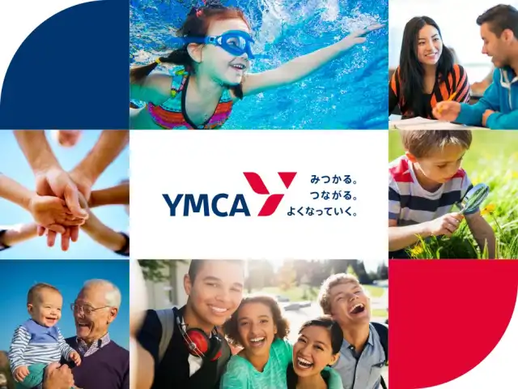
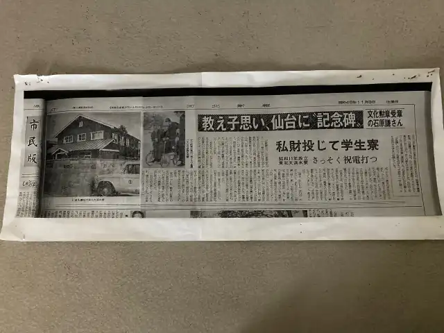

## YMCAについて

東北大学YMCA渓水寮は、これまで日本YMCA同盟の学生YMCAに属していました。YMCAは世界120の国と地域で、およそ6500万人の会員を有するNGOです。東北大学YMCAは2026年度をもって解散し、寮の運営母体が変更します。2027年4月から「東北地区YMCA（仮称）渓水寮」として新しい運営体制で始まります。

YMCAはキリスト教精神を基盤として、日本各地で水泳・サッカーなどのスポーツクラブや幼稚園・保育園の運営、国際交流プログラムやボランティア活動の企画といった社会教育事業を展開しています。

[学生YMCA（日本YMCA同盟）](https://www.ymcajapan.org/society/student/)

## 寮の建物の歴史

東北大学キリスト教青年会が運営していた寮の建物は、1936年、石原謙先生が東北大学に通うクリスチャンやキリスト教に関心を持つ学生のために私財を投じて建てた青年会館に始まります。

戦後、寮の建物は米軍に接収され、1952年4月に返還されました。その後、建物の老朽化が進んだため、1989年に現在地へ新築・移転しました。

東北大学基督教青年会は2026年度をもって解散し、2027年4月から日本YMCA同盟の支援のもと、東北地区学生YMCAとして運営を開始します。

## 渓水寮の概要

- 寮の定員：13名
- 月額費用：53,000円。理事会費（管理費・維持費相当）25,000円、経常費（光熱費・食費など相当）28,000円。YMCAの支援により、家賃はかかりません。
- 建物：鉄筋コンクリート2階建て。1989年渓水寮竣工、築31年。2007年内装改修、2019年外壁塗装、2020年浴室改修。
- 寮生用個室13室、客間、寮母室、ホール、無線LAN5台、全個室有線LAN
- 共同設備：浴室・シャワー室（鍵付き）、男女別トイレ、各階に洗面台3箇所、洗濯機2台、冷蔵庫3台、掃除機2台、テレビ（ホール・客間）、炊事場（自炊可能）、食器類、駐車場、駐輪場

## SNS

- [Twitter（寮生活の様子）](https://twitter.com/keisuiryo)
- [Instagram（寮の食事）](https://instagram.com/keisuiryo)
