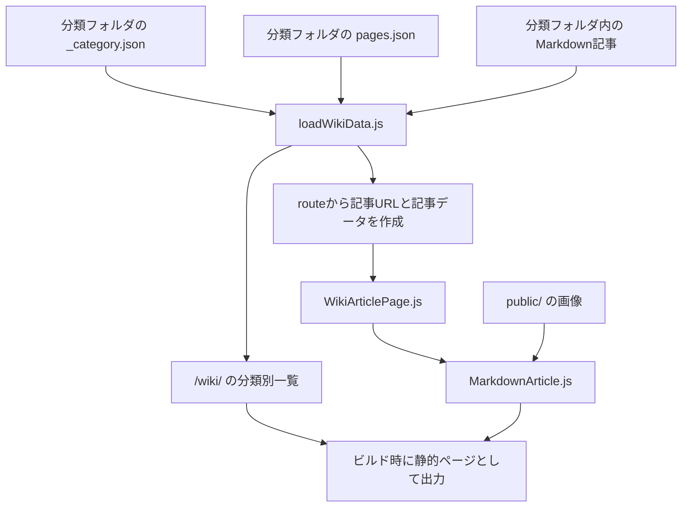

# Wiki表示の仕組み

この文書は、渓水寮ウェブサイトのWikiが、記事原稿から分類一覧・記事ページとして表示されるまでの仕組みと、記事追加時の操作を説明します。

## 使われるファイル・フォルダ

| 場所 | 役割 |
|---|---|
| `content/wiki/` | Wikiの分類設定とMarkdown記事を置く場所 |
| `content/wiki/<分類>/_category.json` | 分類名と分類の表示順を設定する。`title`は画面に出す名前、`order`は分類順。数字が小さい分類から表示される |
| `content/wiki/<分類>/pages.json` | Reactで作られた既存ページをWikiの分類一覧に載せる設定 |
| `content/wiki/<分類>/<記事>.md` | Wiki記事のメタデータと本文 |
| `src/wiki/data/loadWikiData.js` | 分類設定、`pages.json`、Markdown記事を読み込んで表示用データを作る |
| `pages/wiki.js` | `/wiki/`の表示に必要な分類データを渡す |
| `src/wiki/navigation/WikiHomePage.js` | Wikiの分類別記事一覧を表示する |
| `pages/[...slug].js` | 記事の`route`に対応する記事データを選ぶ |
| `src/wiki/articles/WikiArticlePage.js` | 記事タイトル、パンくず、説明、関連記事など共通部分を表示する |
| `src/wiki/articles/MarkdownArticle.js` | Markdown本文を見出し、文章、リンク、画像、表などに変換する |
| `src/wiki/articles/ArticleCards.js` | `{{article-list:...}}`で指定された記事をカード表示する |
| `public/` | Markdown記事などから表示する画像ファイルを置く |
| `next.config.js` | Wikiの記事URLを静的サイト出力に含める |
| `public/sitemap.xml` | 検索エンジン向けURL一覧。現在は手動管理 |

## 現在の移行状況

現在、Reactで作られた既存ページをWikiに掲載しながら、記事本文をMarkdownへ移す作業が進行中です。ReactページをWiki一覧に載せる場合は、そのページをMarkdown記事として追加するのではなく、分類フォルダの`pages.json`に`id`、`title`、`route`を登録します。これはWiki一覧への掲載情報であり、既存ページの本文やURLは変わりません。

本文をMarkdownへ移した記事は、分類フォルダ内に`.md`ファイルを置きます。Markdown記事と`pages.json`の項目が同じ分類内で同じ`route`を持つ場合、Markdown記事の情報が優先されます。

## 表示までのワークフロー



1. `loadWikiData.js`は`content/wiki/`直下のフォルダを分類として扱い、各分類フォルダの`_category.json`と、あれば`pages.json`を読み込みます。そのフォルダ内の`.md`はサブフォルダも含めて再帰的に読み込みます。サブフォルダは記事を整理するためのもので、新しい分類にはなりません。たとえば`content/wiki/つぶやき/文集/場所と活動/ホール.md`も「つぶやき」分類の記事です。
2. `/wiki/`には、分類ごとに記事リンクと説明を表示します。`navigation.show: false`の記事は一覧から隠れますが、個別URLは生成されます。記事の順番はメタデータの`navigation.order`で指定します。
3. 各Markdown記事の`route`から個別URLを作り、共通のReactページへ記事データを渡します。
4. `MarkdownArticle.js`が本文を表示できる要素へ変換します。画像は``で指定し、実ファイルは`public/`に置きます。たとえば`/events/bookclub.webp`は`public/events/bookclub.webp`を参照します。
5. Next.jsが一覧と記事ページをビルド時に静的ファイルとして出力します。

読み込まれたサブフォルダ内の記事も、通常は`/wiki/`の親分類一覧に表示されます。記事メタデータに`navigation.show: false`を指定すると一覧から隠せます。記事URLはフォルダ名やファイル名からではなく、記事ごとの`route`から決まります。

## Markdown記事の追加手順

1. 掲載する分類フォルダを決め、そこに記事の`.md`ファイルを作ります。例：`content/wiki/暮らし/新しい記事.md`。
2. ファイル先頭にメタデータを書きます。`id`、`title`、`route`は必須です。`route`はファイル名と独立した公開URLなので、既存記事と重複させません。

   ```yaml
   ---
   id: new-article
   title: 新しい記事
   route: /new-article/
   description: 記事の短い説明
   navigation:
     order: 30
   ---
   ```

3. メタデータの下に本文を書きます。利用できる記法は、見出し、太字、リンク、単独行の画像、箇条書き、表、区切り線などです。一般的なMarkdownの全機能には対応していません。
4. 画像を使う場合は画像を`public/`以下へ置き、Markdownに``と書きます。指定した画像ファイルが実際にあることも確認します。
5. Reactで作られた既存ページをWiki一覧にだけ掲載する場合は、記事を作らず、分類フォルダの`pages.json`へ`id`、`title`、`route`を追加します。
6. 記事を追加したら`public/sitemap.xml`へURLを追加し、ローカルプレビューでWiki一覧、記事ページ、画像、リンクを確認します。

## 記事一覧用の特殊記法

サブフォルダの記事をカード一覧にするには、一覧ページとなるMarkdownの本文に次の記法を単独行で置きます。

```text
{{article-list:文集/場所と活動}}
```

指定フォルダの記事がカードとして並びます。場所は、その一覧用Markdownファイルが置かれたフォルダを起点に指定します。たとえば`content/wiki/つぶやき/寮生の声・文集.md`に`{{article-list:文集/場所と活動}}`と書くと、`content/wiki/つぶやき/文集/場所と活動/`以下の記事が対象です。並び順は各記事の`navigation.order`で調整できます。

## 表示順の設定の違い

- `_category.json`の`order`：Wiki内の**分類**の並び順。
- 記事メタデータの`navigation.order`：分類内などでの**記事**の並び順。
- 記事メタデータの`navigation.show: false`：個別URLを残したまま、Wiki一覧から記事を隠す。

