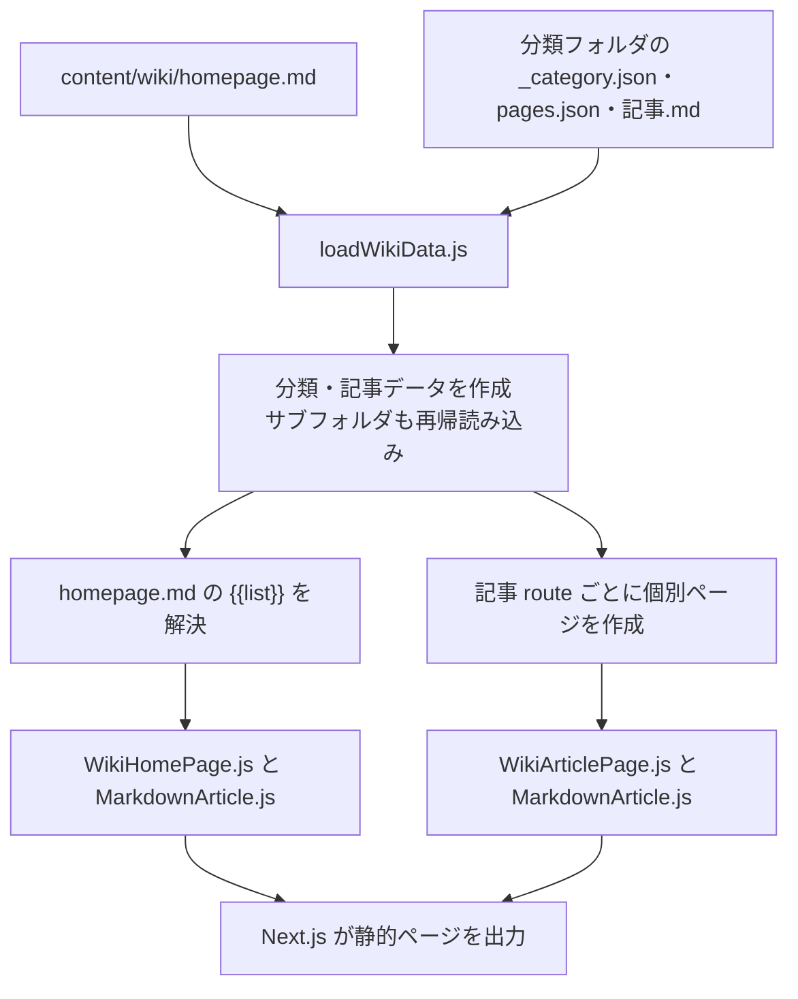

# Wiki表示の仕組み

## フォルダとファイル

```text
content/wiki/
├── homepage.md                 # Wikiホーム。分類ごとの一覧をMarkdownで指定
├── 理念・背景/
│   ├── _category.json          # 分類名・分類順
│   ├── pages.json               # Reactで作った既存ページへのリンク（任意）
│   └── 記事.md
├── 暮らし/
│   ├── _category.json
│   ├── まとめ.md                # 必要に応じて作る通常の記事
│   └── 活動/                    # 記事を整理するフォルダ。別分類ではない
│       └── 記事.md
└── つぶやき/
    ├── _category.json
    ├── 寮生の声・文集.md         # 記事一覧をカード形式で表示
    └── 文集/
        └── 場所と活動/
            └── ホール.md
```

`content/wiki/`直下の既存4フォルダが分類です。各分類の`_category.json`は`title`で表示名を、`order`で分類順を指定します。分類フォルダより下のサブフォルダは記事整理用で、分類は親のままです。今回は新しい分類は追加していません。

`homepage.md`が`/wiki/`の原稿です。分類の見出しと記事一覧をMarkdownに書きます。各記事の`.md`はサブフォルダも含めて読み込まれ、記事の`route`から個別URLが作られます。記事本文は各ファイルのメタデータより後に書きます。

Wikiホームの見出しが`_category.json`の分類名と一致すると、分類の`order`から見出しIDを自動設定します。ナビゲーションも同じIDへリンクするため、`{#...}`をMarkdownに書く必要はありません。

## 読み込みと表示の流れ



`loadWikiData.js`は、まず`content/wiki/`直下の既存分類フォルダを読みます。各フォルダの`_category.json`から分類設定を、`pages.json`がある場合は既存Reactページの一覧情報を取得します。その後、分類フォルダ以下の`.md`をサブフォルダまで再帰的に読み、メタデータと本文を分けて記事データにします。

Wikiホームと記事本文の`{{list}}`は、指定したフォルダの**直下にある記事**を一覧にします。サブフォルダの記事は、親の一覧へ自動で混ぜず、必要なMarkdownからそのサブフォルダを指定します。すべての記事ページは、一覧に載せるかどうかにかかわらずビルド対象です。

## `{{list}}`の書き方

一覧記法は単独行に置きます。フォルダ指定は、そのMarkdownファイルがある場所からの相対パスです。`.`は同じフォルダを表し、表示中の記事自身は一覧から除きます。

```text
{{list:暮らし;view=list}}
{{list:文集/場所と活動;view=cards;limit=4;expand=button}}
```

| 属性 | 意味 |
|---|---|
| `view=list` | 記事名と説明を並べる |
| `view=cards` | 記事カードとして並べる |
| `limit=4` | 最初に表示する件数 |
| `limit=all` | 件数制限なし。省略時も全件表示 |
| `expand=button` | 件数を制限し、残りがある場合に展開ボタンを表示 |

たとえば`content/wiki/homepage.md`の`{{list:暮らし;view=list}}`は、`content/wiki/暮らし/`直下の記事と`pages.json`の項目を一覧にします。`content/wiki/つぶやき/寮生の声・文集.md`の`{{list:文集/場所と活動;view=cards;limit=4;expand=button}}`は、指定フォルダ直下の文集記事をカードにし、4件を超える場合は展開ボタンを出します。

従来の`{{article-list:...}}`もカード形式の互換記法として使えます。新しい原稿では`{{list:...;view=list|cards}}`を使います。

## 記事のメタデータ

Markdown記事の冒頭にYAML形式で`id`、`title`、`route`を指定します。`route`が公開URLです。ファイル名やフォルダ名だけではURLは決まりません。

```yaml
---
id: example
title: 記事タイトル
route: /example/
description: 一覧に表示する説明
navigation:
  order: 10
---
```

`navigation.order`は同じ一覧内の記事順に使います。`navigation.show: false`の記事はWikiホームの分類一覧から除外しますが、個別ページは作られます。記事本文内の`{{list}}`では、指定したフォルダの記事を表示します。

画像は`public/`以下に置き、``で参照します。例：`/events/bookclub.webp`は`public/events/bookclub.webp`です。

## 記事の追加・更新

1. 既存分類のフォルダか、その下の整理用フォルダにMarkdownを置きます。
2. メタデータの`id`、`title`、`route`を設定します。URLの重複を避けます。
3. 必要なら既存のまとめ記事または`homepage.md`に`{{list}}`を追加し、対象フォルダと表示形式を指定します。
4. 既存ReactページをWikiホームに載せる場合は、分類の`pages.json`に`id`、`title`、`route`を登録します。記事本文は移動しません。
5. 新しいURLを追加した場合は`public/sitemap.xml`にもURLを登録します。
6. ローカルプレビューでWikiホーム、記事、リンク、画像、リスト／カード表示を確認し、`npm run build`で静的出力を確認します。

`loadWikiData.js`は現在、`navigation.show`と`navigation.order`を一覧用に扱います。Wikiホームの分類見出しと並び順は`homepage.md`の記述順に従います。
